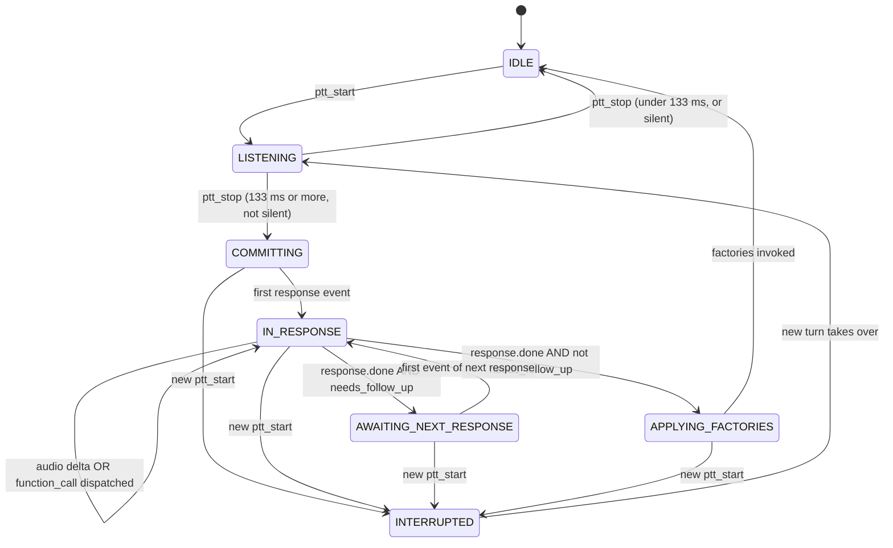

# Turn-based Audio Coordination

> **Status**: **implemented** — landed across 6 staged commits on 2026-04-14 (steps 1–6). The Turn Coordinator is a Huxley framework component (persona-agnostic, skill-agnostic). Spec history: v1 was under-specified (first critic round caught it); v2 over-engineered the audio layer with a named-channel abstraction that had no v1 consumer (self-review caught it after two critic rounds); v3 cuts the channels and ships. Same root-cause fix, ~40% less ceremony than v2. See [ADR — 2026-04-13 — Turn-based coordinator for voice tool calls](./decisions.md#2026-04-13--turn-based-coordinator-for-voice-tool-calls), and the source: [`server/runtime/src/huxley/turn/coordinator.py`](../server/runtime/src/huxley/turn/coordinator.py).

## Purpose

Answer the question: **when the user speaks, the model replies with a mix of audio and tool calls — possibly across multiple model responses — and a tool wants to play a book, who decides the audio playback order, and what happens when the user interrupts mid-sentence?**

Every audio-coordination bug in April 2026 — _book-jumps-in_, _double-ack_, _seek-overlap_, _interrupt-leakiness_, _instruction-text-leak_ — was a symptom of one missing abstraction: _"a user-assistant exchange is a Turn; a Turn owns a strict audio ordering; a Turn's side effects fire only after the model is completely done talking."_ This doc defines that abstraction — no more, no less.

## The contract, in one paragraph

Every user interaction is a **Turn**. A Turn owns one ordering: all of the model's speech (across as many chained OpenAI responses as the model needs to handle info tools) plays first, then any tool-produced audio streams fire in declaration order. The coordinator forwards both kinds of chunks to the same `server.send_audio` pipe in that order — there is no parallel mixing, no per-source queue, no channel abstraction. Tools never touch playback; they return a `ToolResult` with an optional `side_effect` (today an `AudioStream(factory=...)`) that the coordinator invokes at the right moment. Interrupts atomically flush the client queue and cancel the OpenAI response; a press pauses any long-running media task, and the turn's end resumes it (see "Content holds"). A **waiting cue** from the server fills a real wait (a reply slower than 2.5 s, a tool that runs on after the model's "un momento") so a blind user never hears dead air (T1.41; see "The waiting cue" below).

A proactive (injected) turn is said only when a client can hear it, and said again if a disconnect cuts it off (T1.44; see "Proactive turns wait for a listener" below).

## Why v3 is smaller than v2

v2 proposed named audio channels (`speech`, `media`, cut to just those two after the first critic pass), per-channel client queues, an `AudioRouter`, a required `channel` field on the `audio` WebSocket message, and an `EffectKind` enum with `START_STREAM`/`CLEAR_STREAM`/`NONE` values. All of this was architected for a **future** use case (concurrent audio sources — music under news, priority preemption, selective channel flushing) that has no v1 consumer. The actual v1 problem is one-dimensional **sequencing**: _"speech first, then tool audio, in the same turn."_ Sequencing is a coordinator responsibility; it doesn't need a channel model. v3 keeps every substantive bug fix from v2 and cuts the channel ceremony.

**What v3 cuts (zero v1 capability lost)**:

- `AudioChannel` type → gone
- `AudioRouter` → gone
- `EffectKind` enum (`NONE`/`START_STREAM`/`CLEAR_STREAM`) → gone; replaced by `side_effect: SideEffect | None` on `ToolResult`, with `AudioStream(factory=...)` as the first kind
- `channel` field on `audio` and `audio_clear` WebSocket messages → gone; the protocol stays near-unchanged
- Per-channel client-side queues in `playback.ts` → gone; `AudioPlayback` stays as it is today
- Separate `InterruptBarrier` class → gone; interrupt becomes an atomic method on `TurnCoordinator`
- `BARRIER` state as a distinct state → collapsed into the `IN_RESPONSE → APPLYING_EFFECTS` transition

**What v3 keeps (everything that was a real bug fix)**:

- `TurnCoordinator` with its full state machine for chained responses
- The factory pattern (skill declares, coordinator invokes after all model speech)
- Atomic interrupt semantics with the `response_cancelled` drop flag preserved
- Mid-chain interrupt rule (interrupted turns drop all accumulated factories)
- Closure-captured new position for rewind/forward (no premature storage writes)
- `PLAYING` state removal from the session state machine
- Client-side thinking tone anchored on existing protocol signals (superseded 2026-10-12: the waiting cue is the server's, T1.41)

## The primitives — three, not four

### 1. `Turn` — the atomic unit of interaction

```python
class Turn:
    id: UUID
    state: TurnState
    user_audio_frames: int             # chunks received (logged)
    user_audio_bytes: int              # PCM16 bytes received; the 133 ms too-short check measures this
    user_audio_level: PressLevel       # peak / RMS without the first 100 ms and last 60 ms (clicks); peaking under -40 dBFS = silent, not committed
    response_ids: list[str]
    pending_factories: list[Factory]   # accumulated across all responses in this turn
    needs_follow_up: bool              # per-response flag: set when a None-factory tool was called in the current response
    started_at: float
    ended_at: float | None
```

Allocated on `ptt_start`, ends when `state == IDLE` is reached. Strict sequential — at most one active Turn at any time.

**Latching rules for `pending_audio_streams`**:

- **Appended** during `IN_RESPONSE`: every function call whose `ToolResult.side_effect` is an `AudioStream` has its stream appended.
- **Fired** only on the terminal state transition at the end of the chain (after the last `response.done` with no follow-up needed), in declaration order. The last stream wins; each factory is invoked, its chunks forwarded to `server.send_audio`.
- **Cleared** on interrupt — an interrupted turn's streams are dropped, never invoked.

**`needs_follow_up` latching**:

- **Set** when a function call with `side_effect=None` is dispatched during the current response (info tool).
- **Cleared** at the start of each new response in the chain (set fresh for each round's tools).
- **Read** on `response.done`: if set, send `response.create` to request a follow-up narration round; if unset, terminate the turn.

### 2. The side-effect pattern

The skill protocol grows an optional `side_effect` field on `ToolResult`:

```python
class SideEffect:
    kind: ClassVar[str]

@dataclass(frozen=True, slots=True)
class AudioStream(SideEffect):
    kind: ClassVar[str] = "audio_stream"
    factory: Callable[[], AsyncIterator[bytes]]

@dataclass(frozen=True, slots=True)
class ToolResult:
    output: str
    side_effect: SideEffect | None = None
```

Semantics:

- **`side_effect is None`** — info tool. The model needs to narrate the tool output in a follow-up response. Example: `get_current_time`, `search_audiobooks`, `set_volume`.
- **`isinstance(side_effect, AudioStream)`** — side-effect tool. The model pre-narrates before calling (per tool description). After all model speech in the turn, the coordinator invokes `side_effect.factory()`, iterates the async iterator, and forwards PCM chunks to `server.send_audio` as a long-running task. Example: `play_audiobook`, `audiobook_control` for rewind/forward/resume.

`SideEffect` is the extension point: future kinds (notifications, state updates) reuse the same shape and the coordinator dispatches by `isinstance` check.

**Long-running media streams live in a `ContentStreamObserver`** attached to a CONTENT-channel `Activity` on the app-owned `FocusManager`. The observer wraps one `asyncio.Task` slot — the pump running `async for chunk in factory(): await send_audio(chunk)`. On `fm.acquire(activity)`, the actor delivers `FOREGROUND/PRIMARY` which spawns the pump. On `fm.release(CONTENT, interface_name)`, the actor delivers `NONE/MUST_STOP` which cancels it. The coordinator's `_start_content_stream` / `_stop_content_stream` call `fm.wait_drained()` right after acquire/release so the synchronous post-conditions callers expect (pump running, pump dead) are genuine, not "eventually."

The pump outlives turns: an audiobook started in one turn keeps playing across later turns. When a new stream is applied, the coordinator calls `_stop_content_stream()` to cancel the previous observer, then starts a fresh one. Single slot, not a channel abstraction. No queue. The coordinator exposes `current_media_task` as a read-only property for callers who want to await the task directly.

**Content holds (2026-10-12, [ADR](decisions.md#2026-10-12-a-press-pauses-content-the-turns-end-resumes-it-t130)).** A press does not stop the stream; it *holds* it (`ContentStreamObserver.hold("turn")`: pump cancelled, Activity kept). When the user turn is cleared, by any path, a resume is armed: once the client has played the answer (a playhead pushed by every model audio delta, capped at 15 s) and the press's transcript is in (up to 1.5 s more), the hold is released and the observer calls `factory()` again. Not if the turn stopped the stream (`CancelMedia`), asked for another (`AudioStream`, which ends the held one whichever way the dispatch goes), or said only stop words (the persona's `content_stop_words`); a claim or a drained inject parks it first and it comes back after them. Held over 30 min: stopped instead. A missing client (5 s) holds it too (`"no_client"`), until a client is back. A press while the voice session is down (the app rejects it, `on_ptt_rejected`) holds it as `"session"` if the session dropped 5 s ago or less (the planned refresh) and the session coming back releases it (`on_session_connected`); later in an outage the press stops it. While `_apply_side_effects` decides what plays next, an internal `"dispatch"` hold keeps a non-playing stream from starting for a tick before it is replaced.

**Factory contract** (unchanged from v2):

- **Invocation**: called exactly once, by the coordinator, inside the turn's terminal state.
- **Yields**: PCM16 little-endian, 24 kHz, mono; any chunk size.
- **Pacing**: the factory is responsible for realtime pacing (ffmpeg `-re`, explicit `asyncio.sleep`).
- **Cancellation**: the iterator MUST honor cancellation cleanly. On `task.cancel()`, the iterator's next `yield` must tear down any subprocess / file / network resource.
- **Completion**: natural EOF (`StopAsyncIteration`) is fine; the `ContentStreamObserver`'s pump task simply returns, and `coordinator.current_media_task.done()` becomes `True` once it finishes.
- **Errors**: exceptions caught by the coordinator, logged, surface a distinct error tone client-side + status message. **Tested via integration test with a real subprocess**, not unit mock.

**Critical: closure-captured new position for rewind/forward**. The skill does not write `saved_position = new_pos` to storage during dispatch. The new position lives in the factory closure: `lambda: player.stream(path, start=new_pos)`. If the turn is interrupted, the factory is never invoked, and storage is untouched — the stored position still reflects last _actually played_ position, not last _requested_ seek. This fixes an interrupt-atomicity gap in the current code.

### 3. Interrupt — an atomic method on `TurnCoordinator`

Not a separate class. One method with an explicit step order — replaces three layers of hand-rolled partial clearing in the current code.

> **2026-10-12:** step 3 no longer stops the content stream. `interrupt()` ends the turn, not the content: a press holds the stream (pump dead) before calling it, so step 4 still can't race the pump, and reset/shutdown leave content to the FocusManager. The code block below is the original v3 sketch.

```python
class TurnCoordinator:
    response_cancelled: bool   # drop flag — step 1 below

    async def interrupt(self) -> None:
        """Raised on a new ptt_start mid-turn, or on state → IDLE."""
        # Order matters. Do not reorder without updating this doc.
        self.response_cancelled = True                      # 1. drop flag FIRST
        if self.current_turn:
            self.current_turn.pending_factories.clear()     # 2. drop pending factories
        await self._stop_content_stream()                   # 3. cancel producer FIRST
        await self.server.send_audio_clear()                # 4. flush client queue
        await self.speaking_state.force_release()           #    + clear speaker owner
        if self.session.is_connected:                       # 5. cancel model response
            await self.session.cancel_response()
        if self.current_turn:
            self.current_turn.state = TurnState.INTERRUPTED # 6. mark turn
```

**Rationale for step 1 (drop flag first)**: OpenAI audio deltas arrive asynchronously. Between "we sent `response.cancel`" and "OpenAI actually processed it," more deltas can land. The receive loop checks `response_cancelled` before forwarding each delta — if set, the delta is dropped at the receive point. Without the flag, flush + cancel is not atomic: stale deltas could re-fill a just-flushed client queue. The flag is reset by the next commit, so the provider backs it up: after `cancel_current_response` it drops every remaining event of the cancelled response, including its late `response.done`, which would otherwise be taken for the next turn's (2026-10-12), and holds the next `response.create` until that response is done.

**Rationale for step 3 before step 4** (content stream stop before force_release): if force_release ran first, the await window before `_stop_content_stream` completes gives the pump task time to execute `_factory_send_audio`. That callback sees `is_speaking=False` (force_release just cleared it) and calls `acquire(FACTORY)` — leaving `SpeakingState` stuck on a dead pump after cleanup completes. Stop the producer first, then clear the flag; nothing can re-acquire what doesn't exist. Since 2026-10-12 the producer is stopped by the press's hold, before `interrupt()`; the flag is cleared after the `audio_clear` (the walkie drops in-flight audio until `model_speaking=false`). `on_session_disconnected` stops nothing and leaves a playing stream's FACTORY flag alone.

This is **not** a new invention — `session/manager.py:82` has the same flag today. The coordinator takes ownership of it; session manager becomes thin transport.

## Turn lifecycle



**7 states** (down from v2's 8 — the v2 `BARRIER` state was a decision point with no intrinsic behavior, so it's collapsed into the `IN_RESPONSE → APPLYING_FACTORIES` transition).

Key transitions:

- **IN_RESPONSE → AWAITING_NEXT_RESPONSE**: `response.done` arrives AND `needs_follow_up == True` (at least one tool this round had `side_effect=None`). Coordinator sends `response.create` and clears `needs_follow_up` for the next round.
- **IN_RESPONSE → APPLYING_FACTORIES**: `response.done` arrives AND `needs_follow_up == False`. The model has fully finished talking for this turn. If `pending_factories` is non-empty, invoke them in order; if empty, transition directly to `IDLE`.
- **AWAITING_NEXT_RESPONSE → IN_RESPONSE**: first event of the new response.
- **APPLYING_FACTORIES → IDLE**: each pending factory has been invoked. Long-running factories (`ContentStreamObserver` pump) run in the background; the turn doesn't wait for them to complete.
- **Any state → INTERRUPTED**: new `ptt_start` during a live turn calls `coordinator.interrupt()`.
- **Clearing a USER turn** (any of the above, or a too-short press) arms the resume of content its press held. See "Content holds" above.

## Concrete decisions

The 10 questions the first critic round flagged as hand-wavy. v3 answers, often shorter than v2 because the channel layer is gone.

### 1. When does a Turn start and end?

- **Start**: on `ptt_start`. Turn allocated immediately, reachable for interrupt from this moment.
- **End**: `state == IDLE`. Long-running factories outlive the Turn — the turn ends when they're _invoked_, not when they _complete_.

### 2. What does "speech done" mean?

The terminal `response.done` of the chain — one that leaves `needs_follow_up == False`. For a simple turn with one response and a side-effect tool, this is the single `response.done`. For a chained turn (info tool → narration → more), it's the final response's `response.done`. The coordinator's decision rule: _"after each `response.done`, if `needs_follow_up` is set, send `response.create` and loop; else, transition to APPLYING_FACTORIES."_

### 3. `START_STREAM` vs `MODIFY_STREAM` — this question is now moot

No enum. No kinds. If a tool has a factory, the coordinator runs it. If the current `ContentStreamObserver` has a running pump, it's cancelled first. Whether that's _starting fresh_ or _modifying_ is semantics for the tool description, not for the runtime.

### 4. Factory contract

See "The factory pattern" above. Unchanged from v2.

### 5. Rapid PTT / concurrent turns / mid-chain interrupts

**Rule**: at most one Turn is active. A new `ptt_start` while a Turn exists calls `coordinator.interrupt()` (see §"Interrupt" above), then a new Turn starts.

**Mid-chain interrupts**: if a turn has three chained responses and the user interrupts in response 2, all factories accumulated from responses 1 and 2 are dropped. An interrupted turn is always fully cancelled — no partial factory application.

**Storage side effects are non-transactional by design.** If the skill wrote `last_audiobook_id = X` to storage during `handle()`, that write stands. Rollback would need a transaction model — deferred.

**Rewind/forward** no longer write positions to storage during dispatch. Positions live in factory closures; an interrupted rewind = untouched storage.

### 6. Protocol delta

**Tiny**. The channel layer is gone, so `audio` and `audio_clear` messages stay as they are today. The only changes:

- **`state` message**: value set removes `"PLAYING"`, keeps `"IDLE" \| "CONNECTING" \| "CONVERSING"`
- **`turn` message** (new, optional): `{ "type": "turn", "event": "start" \| "end" \| "interrupted", "turn_id": "uuid" }` — dev observability only; the browser client uses it to tag events in the dev panel; the ESP32 client can ignore it

Everything else (`audio`, `audio_clear`, `status`, `transcript`, `model_speaking`, `dev_event`) is unchanged on the wire.

### 7. Session vs Turn lifetime — `PLAYING` state removed

Session state machine simplifies to:

```
IDLE → CONNECTING → CONVERSING → IDLE
```

No `PLAYING`. Media playback is tracked by the coordinator's active `ContentStreamObserver`, not by the session state machine.

**Cost check**: OpenAI Realtime API bills per token. Idle session (no audio flowing, no function calls) = zero tokens = zero cost. The original "save API cost" justification for PLAYING does not hold.

**Mic privacy unchanged**: mic-to-OpenAI forwarding is gated by `_ptt_active`, independent of state. Removing PLAYING does not change what the user's mic streams.

**UX win**: first-press latency after a mid-book interrupt drops from ~1 s (reconnection) to ~0 s (session already open).

### 8. Error handling inside a Turn

- **v1**: catch exceptions in the consumer task, log, stop the factory, emit a distinct error tone client-side + status message. Grandpa hears the tone + silence.
- **v2 (of this spec)**: coordinator re-opens the session and injects a synthetic user message `"el reproductor falló"` for conversational recovery. Deferred.

### 9. `system` skill + the `side_effect=None` path in detail

`system.set_volume` and `system.get_current_time` return `ToolResult(side_effect=None)`. Flow:

1. **IN_RESPONSE** — skill dispatched, result returned. `needs_follow_up = True`. `pending_audio_streams` unchanged.
2. Coordinator sends `function_call_output` to OpenAI.
3. On `response.done`: `needs_follow_up` is set → `AWAITING_NEXT_RESPONSE`. Coordinator sends `response.create`, clears `needs_follow_up`.
4. First event of the new response → `IN_RESPONSE`. Model generates audio narrating the result.
5. On this response's `response.done`: no tools dispatched this round, `needs_follow_up` is still False → `APPLYING_FACTORIES`. `pending_factories` is empty → direct to `IDLE`.

**Mixed response with both a factory tool AND a None-factory tool** (physically possible despite the system prompt rule):

1. Response 1 dispatches `play_audiobook` (factory appended) and `get_current_time` (None-factory; `needs_follow_up = True`).
2. `response.done` → `needs_follow_up` set → `AWAITING_NEXT_RESPONSE`. `response.create` sent.
3. Response 2 narrates the time. `needs_follow_up` stays False (no tools this round).
4. `response.done` → `APPLYING_FACTORIES` → invoke the pending factory → book plays → `IDLE`.

Ordering: pre-narration from response 1 → time narration from response 2 → book audio. Correct.

### 10. Test strategy

**Unit tests** (fast, deterministic):

| Layer                                                 | Tests                                                                                                                            |
| ----------------------------------------------------- | -------------------------------------------------------------------------------------------------------------------------------- |
| `TurnCoordinator` state machine                       | ~12 — one per transition, plus chained-response happy path, plus mid-chain interrupt, plus mixed factory+None tools              |
| `Turn.pending_factories` + `needs_follow_up` latching | ~6 — appends, clears, per-response reset                                                                                         |
| `TurnCoordinator.interrupt()`                         | ~4 — verify 6-step order, drop-flag-first, media task cancelled, session cancel called                                           |
| `AudiobooksSkill.handle()` returns correct factories  | ~18 — existing `test_audiobooks_skill.py` tests, assertions move from `result.action` to `result.audio_factory is None/not None` |
| `SessionManager` receive-loop routing                 | ~4 — event forwarding to coordinator, no own dispatch logic                                                                      |

Net unit tests: **~90** (up from 88 today; ~26 new coordinator/latching/interrupt tests, ~45 existing skill/storage/registry/state tests carried over, offset by ~15 deleted session-manager tests). **v2 projected ~100 tests** including channel tests that v3 doesn't need.

**Integration tests** (`@pytest.mark.integration`):

- `test_audiobook_player.py` — real ffmpeg, real subprocess, real cancellation. Verify the factory contract's cancellation guarantee.
- Full-turn happy path with real OpenAI session (requires `ABUEL_OPENAI_API_KEY`).

**Deleted tests**:

- `test_session_manager.py::test_function_call_dispatches_to_skill` — replaced by coordinator dispatch tests
- `test_session_manager.py::test_function_call_with_action_defers_orchestrator_notification` — replaced by coordinator's latching tests
- Any test asserting on `_pending_tool_action`, `_response_cancelled`, `_fire_pending_action` inside the session manager — behavior moves to the coordinator

**Surviving tests** (no change or trivial update):

- `test_state_machine.py` — unchanged library; only removes PLAYING transitions
- `test_storage.py` — entirely
- `test_skill_registry.py` — entirely
- `test_audiobooks_skill.py` — all tests; assertions updated for the new `ToolResult.audio_factory` field
- `test_config.py` — entirely

## Code shape

### New files

```
server/src/abuel_os/
└── turn/
    ├── __init__.py
    └── coordinator.py      # TurnCoordinator, Turn, TurnState, interrupt method
```

**One new directory, two new files** (down from v2's four). No `audio/` package. No separate `barrier.py`.

### Changed files

- `server/src/abuel_os/types.py` — `ToolResult` gains `audio_factory` field; `ToolAction` enum **removed** (it was only ever `NONE` and `START_PLAYBACK`); `Skill.handle()` signature unchanged at the Python level (same return type, richer field).
- `server/src/abuel_os/session/manager.py` — thin transport: receive event, forward to coordinator. `_pending_tool_action`, `_pending_action_task`, `_response_cancelled`, `_fire_pending_action`, and the whole `_handle_function_call` orchestration block deleted (the drop flag logic moves onto the coordinator).
- `server/src/abuel_os/app.py` — coordinator instantiation; `_on_audiobook_chunk` / `_on_audiobook_finished` / `_on_audio_clear` / `_enter_playing` / `_exit_playing` callbacks removed; `_assistant_speaking` flag removed; `_on_wake_word` audiobook-stop logic removed.
- `server/src/abuel_os/skills/audiobooks.py` — `_play` returns `ToolResult(..., audio_factory=lambda: ...)`. `_control` rewind/forward/resume use the same pattern; no more `_play` delegation hack.
- `server/src/abuel_os/media/audiobook_player.py` — `AudiobookPlayer.stream(path, start_position=0.0)` becomes the factory callable. `load()`/`seek()`/`pause()`/`on_audio_clear` all gone.
- `server/src/abuel_os/state/machine.py` — `PLAYING` state + its transitions + `_enter_playing`/`_exit_playing` callbacks removed.

### Unchanged files

- **`clients/pwa/src/lib/audio/playback.ts`** — stays as-is, modulo the new `playThinkingTone()` method. No per-channel queues. No `play(channel, data)` signature change.
- **`clients/pwa/src/lib/ws.svelte.ts`** — modulo adding the silence-detection timer for the thinking tone, no changes. No channel-field routing.
- **`clients/pwa/src/routes/+page.svelte`** — zero changes from the one-button refactor.
- **Protocol message handlers** — `audio` and `audio_clear` on both sides stay as they are.

### Net LOC

- **New code**: ~300 lines (coordinator + turn + interrupt method + their tests)
- **Deleted code**: ~400 lines (v2 estimate held; the channel-layer code was never written so nothing to delete there, but the existing defer/pending/flag cruft still goes)
- **Net**: **approximately -100 lines** for v3 (v2 projected ~zero net). The repo ends up smaller, not the same size.

## Migration plan — **6 steps**

> **Historical** — all six steps shipped 2026-04-14. Field names below reflect the v3-spec naming used during migration; the field landed as `side_effect: SideEffect | None` with `AudioStream(factory=...)` as the first kind, NOT as a top-level `audio_factory`. Read the current `server/sdk/src/huxley_sdk/types.py` for the actual surface; this section is preserved as a record of the rollout.

Down from v2's 8. Steps for "implement channel queue" and "client per-channel state" disappear because there are no channels.

### Step 1 — Add `audio_factory` field + coordinator stubs

- Add `audio_factory: Callable[[], AsyncIterator[bytes]] | None = None` to `ToolResult`
- Remove `ToolAction` enum (replace all usages with factory-or-None)
- Create `turn/coordinator.py` with empty class + type definitions
- **DoD**: ruff, mypy, all existing tests pass (audiobooks skill temporarily uses `audio_factory=lambda: ...` stubs or still uses the old action field until step 4; decide at implementation time)

### Step 2 — `TurnCoordinator` state machine against a fake OpenAI session

- Drive events manually in unit tests: `ptt_start`, audio delta, function call dispatch, `response.done`, `response.create` for chain, mid-chain interrupt
- Assert state transitions, factory latching rules, `needs_follow_up` flag behavior, `interrupt()` atomicity
- **DoD**: coordinator unit tests pass (~22 new tests across state machine + latching + interrupt)

### Step 3 — Wire the coordinator into `app.py` and `session/manager.py`

- `session/manager.py` becomes a thin transport: receive OpenAI events, forward to coordinator
- `app.py` owns the coordinator, passes it into session manager construction
- Old defer/pending/flag logic removed from `session/manager.py`
- Audiobooks skill temporarily broken (still returns `ToolResult(action=...)`) — fixed in step 4
- **DoD**: coordinator tests + session-manager routing tests pass; audiobook tests expected to fail

### Step 4 — Migrate the audiobooks skill to factories

- `AudiobooksSkill._play()` returns `ToolResult(..., audio_factory=lambda: AudiobookPlayer.stream(path, start=pos))`
- `_control` for rewind/forward/resume returns the same pattern with `start=new_pos` captured in the closure
- `_control` for pause/stop returns `audio_factory=None` (no effect)
- `AudiobookPlayer.stream(path, start_position)` becomes an async generator; `load()`/`seek()`/`pause()`/pause event / on_audio_clear callback deleted
- Update `test_audiobooks_skill.py` assertions
- **DoD**: audiobook unit tests pass

### Step 5 — Remove the `PLAYING` state

- `state/machine.py`: drop `PLAYING` and its transitions
- `app.py`: drop `_enter_playing`, `_exit_playing`, the state-transition observer that used to broadcast PLAYING
- `docs/architecture.md`: update state machine diagram
- `docs/protocol.md`: update `state` enum values
- **DoD**: all tests pass

### Step 6 — Client thinking tone + docs polish

- `clients/pwa/src/lib/audio/playback.ts`: add `playThinkingTone()` method
- `clients/pwa/src/lib/ws.svelte.ts`: silence-detection timer hooked to `ptt_stop` (sent) and `model_speaking: false` (received)
- Update `docs/turns.md` status from "spec v3, not yet implemented" to "implemented"
- Update `docs/architecture.md`: replace the "design in flight" note with the actual coordinator section
- Update `docs/skills/README.md`: new `ToolResult.audio_factory` documentation for skill authors
- Update `docs/skills/audiobooks.md`: current state audit (most gaps close)
- Manual browser smoke: play, pause, resume, rewind, forward, interrupt mid-speech, interrupt mid-book, rapid PTT, `¿qué hora es?` with thinking tone audible in the gap
- **DoD**: all tests pass; browser smoke passes; docs updated

**Total wall-clock**: 2 focused days for steps 1-5 (v2 was 2-3 because steps 2 and 6 existed), plus a half day for step 6 and smoke testing.

## The waiting cue (T1.41)

For a blind user, a silence while the server works is indistinguishable from _"the device is broken."_ ("It told me it was gonna look for some books and then it kept silent for like 10 seconds", Mario, 2026-10-12.)

### Where it lives

**On the server**, in the coordinator (`turn/wait_cue.py`). Until 2026-10-12 this was a client-side tone, anchored on `ptt_stop`; it never covered the wait while a tool runs after the model's preamble, which is the long one, because only the server knows a tool is running. The walkie then needed no firmware change: it plays any audio while `model_speaking` is false. See the ADR "The waiting sound comes from the server" (2026-10-12).

### When it starts

Armed for user turns only (never for injected or completion turns: a reminder isn't something the user is waiting for):

- **A committed `ptt_stop`**: the first blip comes 2.5 s after release with no model audio. Release to first audio measured p50 1.06 s, p90 2.02 s on 233 turns; at the old 1.5 s, one ordinary answer in nine would have got a blip just before the speech.
- **A tool call**: once the client has played what it was sent (`_client_playhead_remaining_s`, a lower bound) plus 1.5 s. A cue already running keeps going.

### When it stops

Before any real sound and on anything that ends the wait: model audio, a `PlaySound`, the turn's side effects (a stream, a claim), a press (the first statement of `on_ptt_start`, before any await, so no blip reaches the open mic), an interrupt, any change of `current_turn`, a session drop. And by itself after 30 s (`reason=cap`): a model that never answers isn't a wait. A blip already being written finishes: stopping never cancels a send, because the walkie's Opus queue is shared and a cancelled drain clears it.

### The sound

One soft struck note (D5 with two quiet partials, 4 ms attack, fast decay, about -16 dBFS), 120 ms (two whole 60 ms Opus frames), every 1.5 s. Not the walkie's offline cue (now said in words, "No tengo conexión", F-0027; a falling 440 / 330 Hz pair if that can't play): waiting must sound like "working". Its audio skips the playhead estimate and `server.tx.audio_stats` (`send_audio(stats=False)`). Logs: `coord.wait_cue_start` (reason, playhead_remaining_ms, waited_ms), `coord.wait_cue_stop` (reason, blips, cue_ms).

Not covered: the moment between a turn's end and a stream's first audio (a Spotify start). The PWA no longer plays its own tone; it keeps the visual "thinking" state until `model_speaking: true`, `audio_clear` or a press.

## Proactive turns wait for a listener (T1.44)

An injected turn (`ctx.inject_turn`, `inject_turn_and_wait`) is spoken only when someone can hear it. Before 2026-10-12 it went ahead with no client connected and was spoken to nobody: a reminder at boot with `HUXLEY_PERSONA_AT_BOOT`, or whenever the walkie dropped off Wi-Fi. See the [ADR](./decisions.md#2026-10-12-proactive-turns-wait-for-a-listener-t144).

### When it waits

In `TurnCoordinator._injected_queue`, while any of these holds (checked again, with no await, right before the turn is created):

- no listener: no client whose hello is out. Read live from the server (`AudioServer.listener_epoch`, a number per connection), not cached: an app being started (boot, a swap, a reload) is not current and misses presence calls;
- no voice session (a reconnect);
- a turn in progress;
- an earlier injected turn still playing on the client (below);
- a live claim, except for PREEMPT.

Content keeps its 5 s grace before it pauses (`_client_absent`); a turn has no stop/start cost to ride out, so it waits at once.

### When it is said

The next waiting turn fires when what blocked it clears: a client arrives (`on_client_presence(True)`, before the no-client content hold is released, so the narration's DIALOG parks the content first), the session connects, the previous turn is confirmed heard, a claim ends (scheduled on the next tick: a claim's end runs inside the FocusManager), a cut-off finishes, a press is dropped (too short or silent), or a turn ends (where the priority branches above still apply). One at a time, the most urgent tier first (PREEMPT, BLOCK_BEHIND_COMMS, NORMAL; with a live claim only PREEMPT), first come first served within a tier, so a 30-second call announcement isn't kept behind a weekend of message announcements; a turn put back goes to the head. Between two waiting turns, what the first parked stays parked (`inject_queue` hold) until the next fires. Every condition is re-checked with no await right before the turn is created, and again after DIALOG focus is taken: a press or a disconnect in between ends it before any prompt is sent.

### Heard, or not

A turn that ends normally is said, not yet heard: the model streams faster than real time, so the walkie may still have seconds of it to play, and a Wi-Fi drop the server hasn't noticed swallows audio without an error. It is confirmed once the client's playhead (the estimate content holds use) has passed and the client it was said to answers a WebSocket ping (TCP is ordered: the pong proves everything before it arrived). The ping is bounded at 15 s, write included; on timeout the server aborts the connection so the walkie reconnects. Until then the next waiting turn doesn't fire, so a drop or a press during one turn can't swallow the next one queued behind it in the client's buffer. `inject_turn_and_wait` returns at that confirmation, which is also what keeps a chained `start_input_claim` from cutting the announcement off.

Not heard, and back to the head of the queue, said again whole with a note to the model (`inject_repeat_note`, persona-translatable: "the user did not hear this; say it again in full"):

- the client left or was replaced (an eviction counts: a reconnecting walkie evicts its dead socket) while the turn was being said (the response is cancelled) or before its confirmation;
- the ping failed or timed out; nothing fires into that connection again;
- the voice session dropped mid-turn, or the prompt's send failed (the turn is ended, not left holding DIALOG);
- the response said nothing and ran no tool (a failed one);
- a press before the turn's audio had started playing (it was queued behind the previous answer, and the press empties the client's buffer); it follows the user's turn. A press while it plays counts as heard.

### Expiry, dedup, persistence

- `expires_after` (default 10 min, `DEFAULT_INJECT_EXPIRY`; `None` waits until heard) counts from the call and only while the turn waits: a turn being said is never cut for it, and one cut off after its deadline is EXPIRED, not said again. An expiry timer resolves it at its deadline.
- A queued turn with the same `dedup_key` is replaced in its place; a same key being said or awaiting its confirmation drops the newcomer.
- Cancelling `inject_turn_and_wait` withdraws a turn still waiting; a turn already being created goes on whole (the fire is shielded from the caller).
- At most 5 attempts per turn (`_MAX_ATTEMPTS`): each is a paid response, and a link that keeps flapping or a provider that keeps failing gets no more. Then DROPPED.
- Memory only: a restart loses waiting turns, and skills that persist re-fire from their own storage at setup (reminders do; timers don't, by design). `close()` drops what waits (DROPPED) and counts a turn the client finished playing as heard.

### What doesn't change

- No new earcon: a turn delivered late sounds like one delivered on time (proactive earcons were deferred at T1.2 and never built).
- The waiting cue never arms for injected turns (only `TurnSource.USER`, at commit and at a tool call); a cut-off ends the turn through the `current_turn` setter, which disarms it like every other path.
- Nothing new on the wire: the ping is an RFC 6455 control frame every client already answers. `/health` adds `injects_waiting` and `oldest_inject_wait_s`.

Logs: [observability.md](./observability.md#inject_turn-queue-events--diagnosing-dropped-or-queued-reminders).
## Open questions

Deferred explicitly, with reason:

- **Transactional rollback on interrupt**: accepted as eventual consistency per §5. Revisit if user confusion surfaces.
- **Audible error recovery mid-stream**: v1 = tone + silence; v2 = conversational re-inject. Deferred.
- **Named channels / per-stream routing**: v3 deliberately cuts the channel layer because v1 has exactly one concurrent-stream rule to enforce (speech before media in a turn), and sequencing solves that without channels. **When we need multi-stream mixing** — background music under a news clip, priority preemption of speech by a critical alert, concurrent media during proactive speech — we add channels _then_. The cost of adding them later is approximately the cost of adding them now, and by then we'll know the actual use cases instead of speculating. The right trigger for the channel refactor: the first v2 skill that legitimately wants concurrent audio sources on the same client.
- **Priority preemption across channels** — same as above.
- **Persistent turn history** (replay, debugging): dev events suffice for v1.
- **Coordinator distributed across processes**: v1 is in-process.
- **Non-audio effects** (storage writes, external API calls): happen naturally inside `handle()`; the factory pattern only models _audio_ side effects.
- **Tool chaining with multiple function calls in one response**: OpenAI allows it. v1 dispatches each in order, accumulates factories, handles the NONE-factory follow-up uniformly. System-prompt rule _"one tool at a time"_ is advisory, not server-enforced.
- **Error tone specification**: listed in sound design as deferred. Design when the error recovery path lands.

## Source-of-truth pointers

| Concept                                                  | File                                                               |
| -------------------------------------------------------- | ------------------------------------------------------------------ |
| `Turn`, `TurnState`, `TurnCoordinator`, interrupt method | `server/runtime/src/huxley/turn/coordinator.py`                     |
| `ToolResult.side_effect`, `SideEffect`, `AudioStream`    | `server/sdk/src/huxley_sdk/types.py`                             |
| `AudiobookPlayer.stream()` factory                       | `server/skills/audiobooks/src/huxley_skill_audiobooks/player.py` |
| Thinking tone (client)                                   | `clients/pwa/src/lib/audio/playback.ts` (`playThinkingTone()`)             |
| Silence-detection timer (client)                         | `clients/pwa/src/lib/ws.svelte.ts`                                         |
| Protocol delta                                           | `docs/protocol.md`                                                 |

(File paths reflect the post-stage-1 workspace layout. Sections of this doc that describe the migration steps themselves still reference `server/src/abuel_os/...` — those are historical and intentionally left as-is.)
